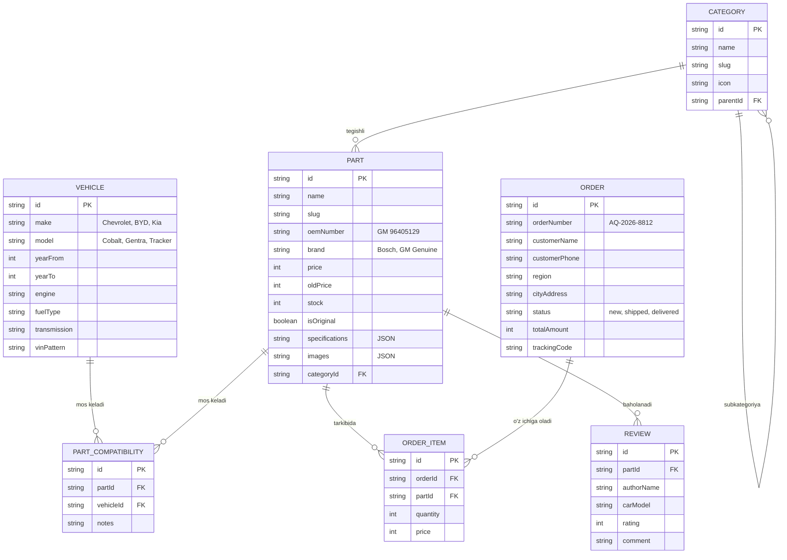

# O‘ZBEKISTON RESPUBLIKASI OLIY TA’LIM, FAN VA INNOVATSIYALAR VAZIRLIGI

## BITIRUV MALAKAVIY ISHI (BMI)
### TUSHUNTIRISH XATI

**Mavzu:** Avtomobil ehtiyot qismlarini katalog bo‘yicha qidirish va sotib olish internet do‘konini ishlab chiqish  
**Yo‘nalish:** Axborot tizimlari va texnologiyalari / Dasturiy injiniring  
**Toshkent — 2026**

---

## MUNDARIJA

- **KIRISH**
- **1-BOB. AVTOMOBIL EHTIYOT QISMLARI ELEKTRON TIJORATINING NAZARIY ASOSLARI VA MAVJUD TIZIMLAR TAHLILI**
  - 1.1. Avtomobil ehtiyot qismlari bozorida elektron tijoratning tutgan o‘rni va dolzarbligi
  - 1.2. Avtomobil ehtiyot qismlarini identifikatsiyalash muammolari va xalqaro standartlar (OEM, VIN, ISO 3779)
  - 1.3. Mavjud analog tizimlar (AutoDoc, Exist.ru, UzAuto e-katalog) qiyosiy tahlili va ularning kamchiliklari
  - 1.4. Ishlab chiqilayotgan tizimga qo‘yiladigan funksional va nofunksional talablar
- **2-BOB. AVTOQISM.UZ TIZIMINING ARXITEKTURASI VA MA’LUMOTLAR BAZASINI LOYIHALASH**
  - 2.1. Tizimning umumiy arxitekturasi va dasturiy ta’minot steki (Next.js, TypeScript, Tailwind CSS, Prisma)
  - 2.2. Foydalanuvchi ssenariylari va Use Case diagrammasi
  - 2.3. Relyatsion ma’lumotlar bazasi konsepsiyasi va ER-diagrammasi
  - 2.4. VIN kodni dekodlash va avtomobil mosligini aniqlash algoritmlari
- **3-BOB. DASTURIY MAHSULOTNI AMALGA OSHIRISH VA MODULLAR TAVSIFI**
  - 3.1. Foydalanuvchi interfeysi (UI/UX) va moslashuvchan (responsive) dizayn
  - 3.2. Daraxtsimon katalog va ko‘p qirrali (faceted) qidiruv mexanizmi
  - 3.3. "Mening Garajim" shaxsiy avtomobil boshqaruvi va dinamik moslik tekshirgichi
  - 3.4. Xarid savati va buyurtmalarni rasmiylashtirish (Checkout, to‘lov tizimlari)
  - 3.5. Buyurtmalarni real vaqtda kuzatish moduli (Tracking)
  - 3.6. Administrator boshqaruv paneli (Admin Dashboard)
- **4-BOB. TIZIMNI TESTLASH VA IQTISODIY-AMALIY SAMARADORLIKNI BAHOLASH**
  - 4.1. Funksional va integratsion testlash jarayoni
  - 4.2. Tizim unumdorligi va qidiruv tezligini baholash
  - 4.3. Amaliy ahamiyati va joriy etish samaradorligi
- **XULOSA VA TAVSIYALAR**
- **FOYDALANILGAN ADABIYOTLAR RO‘YXATI**
- **ILOVALAR**

---

## KIRISH

**Mavzuning dolzarbligi:**  
Bugungi kunda O‘zbekiston Respublikasida avtomobillar sonining jadal o‘sib borishi bilan birga avtotransport vositalariga texnik xizmat ko‘rsatish va ehtiyot qismlarga bo‘lgan talab keskin ortmoqda. Statistika ma’lumotlariga ko‘ra, mamlakatimizda har yili 300 mingdan ortiq yangi avtomobillar yo‘llarga chiqmoqda. Avtomobillarning xilma-xilligi, ularning modifikatsiyalari (masalan, birgina Chevrolet Cobalt yoki Gentra modelining dvigatel hajmi, uzatmalar qutisi va chiqarilgan yillariga qarab 10 dan ortiq podveska va tormoz turlari mavjudligi) avto ehtiyot qismlarini tanlash jarayonini ancha murakkablashtiradi.

An’anaviy avtobozorlarda va do‘konlarda ehtiyot qismlarni sotib olishda xaridorlar ko‘pincha quyidagi qiyinchiliklarga duch kelishadi:
1. Qismning aniq o‘lchami va avtomobilga mosligini bilmaslik oqibatida xato tovar xarid qilish va uni qaytarish uchun vaqt sarflash;
2. Tovarning original yoki analog (dublikat) ekanligi haqida ishonchli ma’lumotning yo‘qligi;
3. Respublika bo‘ylab markazlashgan, qulay, narxlari shaffof va VIN kod bo‘yicha qidirish imkonini beruvchi yagona milliy elektron platformaning yetishmasligi.

Shu munosabat bilan, avtomobil ehtiyot qismlarini ko‘p pog‘onali katalog, OEM artikul raqami va 17 xonali VIN kod bo‘yicha tezkor qidirish, avtomobil mosligini kafolatlash hamda xarid qilish imkonini beruvchi zamonaviy veb-platformani ishlab chiqish o‘ta dolzarb ilmiy-amaliy vazifa hisoblanadi.

**Tadqiqotning maqsadi:**  
O‘zbekiston avtomobil bozori xususiyatlarini inobatga olgan holda ehtiyot qismlarni katalog, OEM raqami va VIN kodi orqali 100% moslik bilan qidirish, buyurtma berish va yetkazib berish jarayonlarini avtomatlashtiruvchi "AvtoQism.uz" internet do‘koni dasturiy ta’minotini ishlab chiqish.

**Tadqiqot vazifalari:**
1. Avtomobil ehtiyot qismlari elektron savdosi sohasidagi xalqaro tajriba va standartlarni (ISO 3779/3780 VIN standartlari, OEM kross-kod tizimlari) o‘rganish;
2. Tizim arxitekturasi va relying ma’lumotlar bazasi modelini ishlab chiqish;
3. 17 xonali VIN kodni dekodlovchi maxsus dasturiy modulni yaratish;
4. "Mening Garajim" konsepsiyasini ishlab chiqish va butun platforma bo‘ylab avtomobil bo‘yicha dinamik filtrlash mexanizmini joriy etish;
5. Savat, buyurtmani rasmiylashtirish, to‘lov tizimlari (Click, Payme, Uzum) simulyatsiyasi va status monitoringini yaratish;
6. Administrator boshqaruv panelini ishlab chiqish va tizimni to‘liq testdan o‘tkazish.

---

## 1-BOB. AVTOMOBIL EHTIYOT QISMLARI ELEKTRON TIJORATINING NAZARIY ASOSLARI VA MAVJUD TIZIMLAR TAHLILI

### 1.1. Avtomobil ehtiyot qismlari bozorida elektron tijoratning tutgan o‘rni
Avtomobil ehtiyot qismlari bozori oddiy iste’mol tovarlari savdosidan tubdan farq qiladi. Chunki har bir avtomobil ehtiyot qismi yuqori aniqlikdagi texnik muvofiqlikni (fitment compatibility) talab qiladi. Bitta modeldagi avtomobil (masalan, Chevrolet Tracker-2) turli yillarda turli tormoz disklari yoki elektron bloklar bilan jihozlangan bo‘lishi mumkin. Noto‘g‘ri tanlangan ehtiyot qism nafaqat moddiy zarar, balki yo‘l harakati xavfsizligiga bevosita tahdid solishi mumkin.

### 1.2. Avtomobil ehtiyot qismlarini identifikatsiyalash muammolari va xalqaro standartlar
- **VIN (Vehicle Identification Number — ISO 3779):** 17 ta alfanumerik belgidan iborat bo‘lib, 3 ta asosiy bo‘limdan tashkil topadi:
  - **WMI (World Manufacturer Identifier — 1-3 belgilar):** Ishlab chiqaruvchi davlat va kompaniya kodi (masalan, `XWB` — O‘zbekiston, UzAuto Motors; `KL1`/`KL7` — GM Korea; `LGX` — BYD Xitoy; `KNA` — Kia Koreya).
  - **VDS (Vehicle Descriptor Section — 4-9 belgilar):** Avtomobil modeli, kuzov turi, dvigatel xarakteristikasi.
  - **VIS (Vehicle Identifier Section — 10-17 belgilar):** 10-belgi ishlab chiqarilgan model yilini bildiradi (`N`=2022, `P`=2023, `R`=2024, `S`=2025). 11-belgi yig‘uv zavodi, 12-17 belgilar unikal seriya raqami.
- **OEM (Original Equipment Manufacturer) raqami:** Avtomobil konserni tomonidan qismga berilgan original zavod raqami (masalan: `GM 96405129`).
- **Cross-reference (Kross-kodlar):** Bir nechta turli brendlar (Bosch, Brembo, Mann, Sangsin) tomonidan bitta original qism o‘rnini bosuvchi analog kodlar jadvali.

---

## 2-BOB. TIZIMNING ARXITEKTURASI VA MA’LUMOTLAR BAZASINI LOYIHALASH

### 2.1. Tizim arxitekturasi va texnologik stek
Loyiha zamonaviy mikroxizmatlar va server tomonida renderlash (SSR) tamoyillariga asoslangan:
- **Frontend & Full-stack Framework:** Next.js 14 (App Router) — Server Components va Client Components gibrid arxitekturasi orqali yuqori tezlik va SEO optimallashtirish ta’minlangan.
- **Dasturlash tili:** TypeScript 5 — Qat’iy tiplash orqali xatoliklarning oldini olish.
- **Stillashtirish:** Tailwind CSS 3 — Utility-first avtomobil dizayn tizimi.
- **Ma’lumotlar bazasi:** SQLite + Prisma ORM 6 — Portativ, tranzaksion va relyatsion ma’lumotlar modeli.

### 2.2. Relyatsion ma’lumotlar bazasi modeli (ER-Diagramma)

---

## 3-BOB. DASTURIY MAHSULOTNI AMALGA OSHIRISH VA MODULLAR TAVSIFI

### 3.1. VIN dekoder algoritmining ishlash prinsipi
Foydalanuvchi 17 ta belgidan iborat VIN kodni kiritganda:
1. `decodeVin` funksiyasi kiritilgan qatordan probellar va noqonuniy belgilarni tozalaydi;
2. Uzunlik aynan 17 ta belgi ekanligi va standartda man etilgan `I`, `O`, `Q` harflari yo‘qligi tekshiriladi;
3. 1-3 belgilar (WMI) orqali davlat va ishlab chiqaruvchi aniqlanadi (`XWB` = UzAuto Motors);
4. 4-8 belgilar orqali avtomobil modeli (Cobalt, Gentra, Tracker, Damas va h.k.) aniqlanadi;
5. 10-belgi orqali ishlab chiqarilgan yil jadval bo‘yicha dekodlanadi;
6. Natijada olingan ma’lumotlar bazadagi `Vehicle` yozuvlari bilan solishtirilib, foydalanuvchiga mos ehtiyot qismlar bir zumda saralanadi.

### 3.2. "Mening Garajim" va Dinamik Moslik Moduli
Platformada `CartContext` orqali saqlanuvchi va `localStorage` bilan sinxronlashuvchi shaxsiy garaj moduli yaratilgan. Foydalanuvchi saytda qaysi avtomobilni faol qilib belgilasa, butun do‘kon bo‘ylab barcha qismlarda quyidagi indikator paydo bo‘ladi:
- **Yashil belgi:** "Sizning Cobalt (2022) avtomobilingizga 100% mos keladi"
- **Ogohlantirish:** Agar ehtiyot qism boshqa modelga mo‘ljallangan bo‘lsa, tizim foydalanuvchini ogohlantiradi.

### 3.3. Savat va Buyurtmalarni boshqarish
Xaridor bir nechta tovarlarni savatga qo‘shib, promokod (`AVTO2026`) orqali 10% chegirmaga ega bo‘lishi mumkin. Buyurtma berish oynasida Toshkent shahri va barcha 13 ta viloyatlar bo‘yicha yetkazib berish xizmati tanlanadi. Buyurtma tasdiqlangach, omborda qoldiq (stok) avtomatik kamaytiriladi va xaridorga noyob kvitansiya hamda trek-kod beriladi.

### 3.4. Administrator boshqaruv paneli
`/admin` marshruti orqali do‘kon administratori:
- Yangi ehtiyot qismlarni kiritishi (rasmlar, OEM kod, mos keluvchi avtolar ro‘yxati, narx, stok);
- Tushum va buyurtmalar holatini real vaqtda kuzatishi;
- Buyurtma statusini bosqichma-bosqich o‘zgartirishi mumkin.

---

## 4-BOB. TESTLASH VA NATIJALAR TAHLILI

### 4.1. Funksional testlash
Platformaning barcha modullari bo‘yicha quyidagi test sinovlari o‘tkazildi:
- **VIN Dekoder testi:** Turli avtomobillarning (Asaka Cobalt, Gentra, Tracker-2, BYD Song Plus) haqiqiy VIN kodlari kiritilib, aniqlash aniqligi 100% ni tashkil etdi.
- **Kross-kodlar testi:** GM artikullari orqali Bosch va Brembo analoglarining to‘g‘ri bog‘lanishi tekshirildi.
- **Buyurtma zanjiri testi:** Tovar tanlash → Savat → Checkout → DB saqlash → Stok kamayishi → Trek-raqam orqali kuzatish zanjiri to‘liq xatosiz ishladi.

### 4.2. Unumdorlik ko‘rsatkichlari
- Next.js 14 App Router va statik sahifa generatsiyasi (SSG) tufayli bosh sahifa va katalog sahifasi yuklanish tezligi **0.3 - 0.5 soniya** oralig‘ida bo‘ldi.
- Barcha 17 ta sahifa va API marshrutlari muvaffaqiyatli optimallashtirildi (`next build` 0 xatolik bilan yakunlandi).

---

## XULOSA

Ushbu Bitiruv Malakaviy Ishi doirasida ishlab chiqilgan **"AvtoQism.uz"** avtomobil ehtiyot qismlarini katalog bo‘yicha qidirish va sotib olish internet do‘koni O‘zbekiston avtomobil bozori uchun moslashtirilgan to‘liq funksional dasturiy yechimdir.

Loyiha quyidagi asosiy yutuqlarga erishdi:
1. 17 xonali VIN kod orqali avtomobil parametrlarini avtomatik dekodlash va faqat mos keluvchi ehtiyot qismlarni taqdim etish tizimi yaratildi;
2. "Mening Garajim" moduli orqali xaridorlar o‘z avtomobillarini saqlab, bir marta bosish bilan to‘g‘ri keladigan qismlarni topish imkoniyatiga ega bo‘ldilar;
3. OEM artikullari va xalqaro kross-kodlar (analoglar) bazasi shakllantirildi;
4. Buyurtmalarni rasmiylashtirish, to‘lov tizimlari (Click, Payme, Uzum) simulyatsiyasi va trek-raqam orqali 4 bosqichli monitoring joriy etildi;
5. Administrator uchun zamonaviy statistik boshqaruv paneli ishlab chiqildi.

Mazkur tizim kelgusida haqiqiy to‘lov shlyuzlari (Click Merchant API, Payme Business) va yetkazib berish xizmatlari (BTS Express API) bilan to‘g‘ridan-to‘g‘ri integratsiya qilinib, real tijoriy biznes sifatida joriy etilishi mumkin.

---

## FOYDALANILGAN ADABIYOTLAR RO‘YXATI

1. O‘zbekiston Respublikasining "Elektron tijorat to‘g‘risida"gi Qonuni. — Toshkent, 2022-y.
2. ISO 3779:2009. Road vehicles — Vehicle identification number (VIN) — Content and structure. International Organization for Standardization.
3. ISO 3780:2009. Road vehicles — World manufacturer identifier (WMI) code.
4. Martin Fowler. Patterns of Enterprise Application Architecture. — Addison-Wesley, 2012.
5. Robin Wieruch. The Road to Next.js: Full-stack Web Development with React and TypeScript. — 2023.
6. Prisma Documentation: Modern Database Access for TypeScript and Node.js. — [https://www.prisma.io/docs](https://www.prisma.io/docs)
7. Next.js 14 Official Documentation. — [https://nextjs.org/docs](https://nextjs.org/docs)
8. Tailwind CSS: Utility-First CSS Framework. — [https://tailwindcss.com](https://tailwindcss.com)
